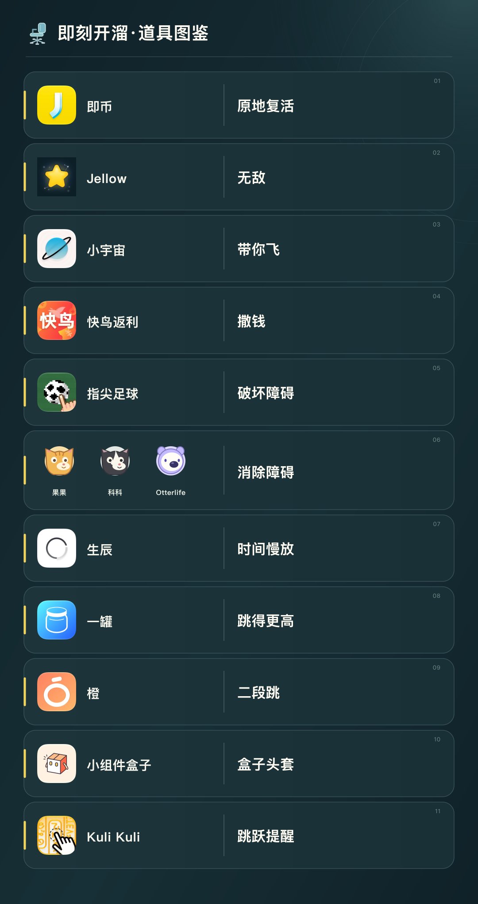

# Jikerun · 即刻开溜

一个基于 Canvas 2D、JavaScript 模块和 Web Audio 的网页小游戏。坐上转椅，在城市街景中跳过障碍、收集道具。

## 本地试玩

无需安装第三方依赖。安装 Python 3 后：

1. 下载或克隆本仓库，进入项目文件夹。
2. 运行 `python3 game/serve.py --open`。
3. 若浏览器没有自动打开，访问 <http://localhost:5173>。
4. 点击“开溜”，按空格跳跃；方向上键使用已获得的技能，P 或 Esc 键暂停。顶部“沿途风景”可固定城市或每局自动轮换（共 8 座地标城市）。触屏设备可轻点空白画面跳跃。

**成功标志：**出现“记录瓦 遇见椅”的首页，点击“开溜”后人物坐在转椅上向前滑行。

关闭试玩：在启动服务的终端中按 Control + C。

## 手机试玩

电脑和手机连接同一 Wi-Fi，在项目文件夹运行 `python3 game/serve.py --lan`，然后在手机浏览器访问 `http://电脑的局域网IP:5173`。

**访问范围：**默认服务仅限本机；使用 `--lan` 后，同一局域网的设备可以访问游戏文件，试玩结束请关闭服务。

## 道具图鉴



## 项目内容

- `game/`：可独立运行的网页代码、本地试玩服务和逻辑测试。
- `game/assets/`：网页运行时使用的图标资源。
- `docs/`：README 使用的说明图。

仓库只收录网页相关文件，不包含原始视频、参考素材或效果预览。

## 运行检查

安装 Node.js 18 或更高版本（需支持 `node --test`，Node 16 会报错）后，在项目文件夹运行：

```bash
cd game
npm test
```

**成功标志：**测试结果中失败数为 0。

## 存档说明

最高分、声音设置和城市轮换位置保存在当前浏览器。本项目没有账号系统、联网排名或付费功能。
